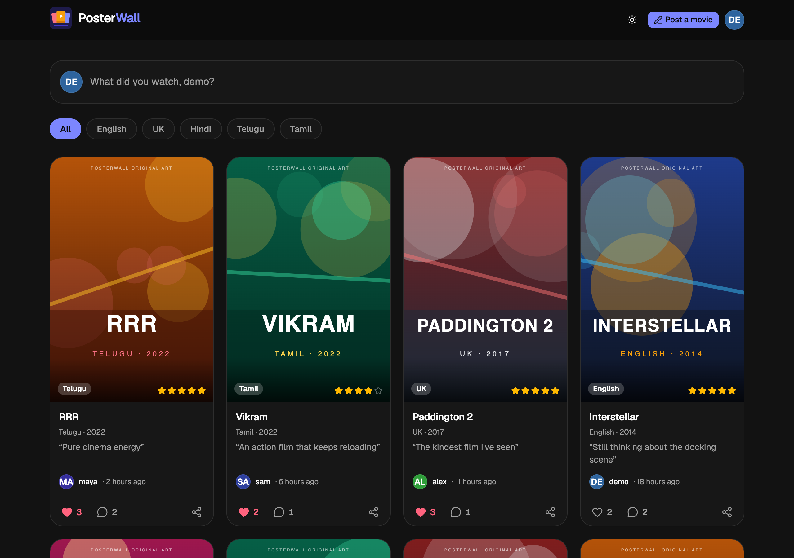
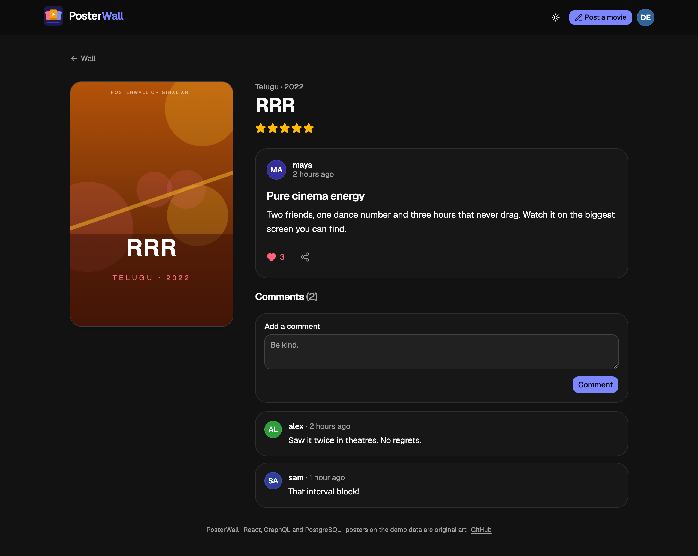
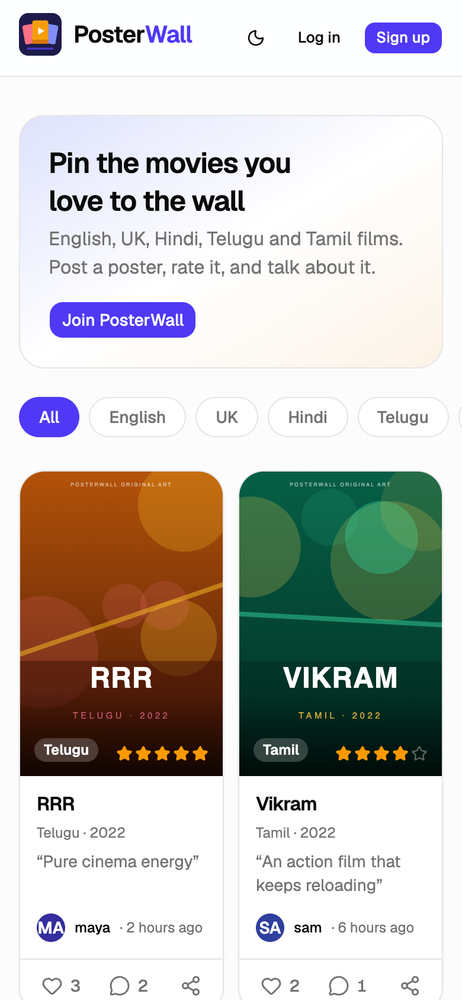
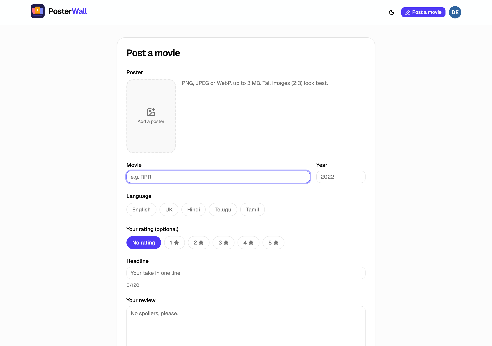

# PosterWall

A wall of movie posters: **English, UK, Hindi, Telugu and Tamil** films. Post a movie with its poster, rate it, and
talk about it: likes, comments and share links. Built with **React 19, GraphQL and PostgreSQL**, as the rebuilt version
of two 2025 projects: this repo's first version (React + Express REST + MySQL, kept at tag
[`v1-rest-mysql`](https://github.com/sujithsadineni/posterwall/tree/v1-rest-mysql)) and [Myposts.com](https://github.com/sujithsadineni/Myposts.com) (a
GraphQL + PostgreSQL start). Rebuilt step by step with [Claude Code](https://claude.com/claude-code).
What changed and why: **[docs/LEARNED.md](docs/LEARNED.md)**.

**[Try the demo →](https://sujithsadineni.github.io/posterwall/)** — the real app on GitHub Pages, with the GraphQL schema
running in your browser instead of on a server. Log in as `demo` / `demo1234`; your changes stay on your device.



| A movie                                                    | On a phone                                                    | Posting                                                   |
| ---------------------------------------------------------- | ------------------------------------------------------------- | --------------------------------------------------------- |
|  |  |  |

Posters in the demo data are **original art drawn by code** (`api/src/db/poster-art.ts`), not studio posters.

## What it does

- The wall: newest posters first, filter by language (kept in the address, `?lang=telugu`), "Load more" pages
- Post a movie: title, year, language, 1–5 star rating, poster upload (PNG / JPEG / WebP, up to 3 MB), headline and review
- Movie page: big poster, details, likes that show instantly, comments, share (the phone's share sheet, or copy link)
- Edit and delete your own posts and comments; deleting or replacing a post removes its old poster file
- Sign up / log in / log out with an httpOnly session cookie; profiles show each person's posters
- Light and dark, fits a phone, keyboard and screen-reader friendly, respects reduced motion

## Stack

|              |                                                                                                                                                |
| ------------ | ---------------------------------------------------------------------------------------------------------------------------------------------- |
| API (`api/`) | Node 22+ running TypeScript directly · Express 5 · Apollo Server 5 · Drizzle ORM · PostgreSQL · zod · jose · DataLoader · multer               |
| Web (`web/`) | Vite 8 · React 19 · TypeScript · Tailwind v4 · shadcn/ui (Radix) · Apollo Client 4 · GraphQL Codegen · React Router · react-hook-form · motion |
| Tests        | node:test against a real test database (41) · Playwright on desktop and phone sizes (17 scenarios × 2)                                         |

## Spin it up locally

You need **Node 22 or newer** and **PostgreSQL 15 or newer**. On a Mac with Homebrew:

```sh
brew install node postgresql@17
brew services start postgresql@17
```

Then, from the repo folder:

```sh
npm install                            # installs both apps (npm workspaces: api/ and web/)

createdb posterwall                    # the database
cp api/.env.example api/.env           # settings for the API
openssl rand -hex 32                   # paste the output as JWT_SECRET= in api/.env

npm run db:migrate -w api              # create the tables
npm run db:seed -w api                 # 10 films with poster art, comments and likes

npm run dev:api                        # terminal 1: GraphQL API on http://localhost:4100/graphql
npm run dev:web                        # terminal 2: the app on http://localhost:5180
```

Open http://localhost:5180 and log in as `demo` / `demo1234` (also `alex` / `alex1234`, `sam` / `sam12345`,
`maya` / `maya1234`), or sign up. Uploaded posters are stored in `api/uploads/` (git-ignored).

| Problem                                  | Fix                                                                              |
| ---------------------------------------- | -------------------------------------------------------------------------------- |
| `DATABASE_URL is not set`                | `cp api/.env.example api/.env`                                                   |
| `JWT_SECRET must be set, 32+ characters` | put the `openssl rand -hex 32` output after `JWT_SECRET=` in `api/.env`          |
| `database "posterwall" does not exist`   | `createdb posterwall` (Postgres must be running)                                 |
| Port 4100 or 5180 already in use         | set `PORT=` in `api/.env`; run the web app with `npm run dev:web -- --port 5181` |

## Tests

```sh
createdb posterwall_test && npm test           # API: auth, owner rules, movie fields, uploads, language filter, query count
createdb posterwall_e2e && npm run test:e2e    # browser: your installed Google Chrome, its own database, uploads and ports
```

After changing `api/src/schema.graphql`, run `npm run codegen` to regenerate the web app's types.

## The GitHub Pages demo

Pages only hosts files, so `npm run build:demo -w web` builds a version where one module (`web/src/demo/transport.ts`)
replaces the network: the API's own `schema.graphql` runs in the browser (Apollo `SchemaLink`) with resolvers that
follow the server's rules, over the same seed data (`api/src/db/seed-data.ts`), saved in `localStorage`. Uploaded
posters are shrunk in the browser and kept with it. The normal build contains none of this.
`.github/workflows/pages.yml` publishes it on every push to `main`.

```sh
cd web && npm run build:demo && npx vite preview --mode demo --outDir dist-demo   # http://localhost:4173/posterwall/
npm run test:demo -w web      # 8 scenarios × desktop and phone, against the built demo
```
